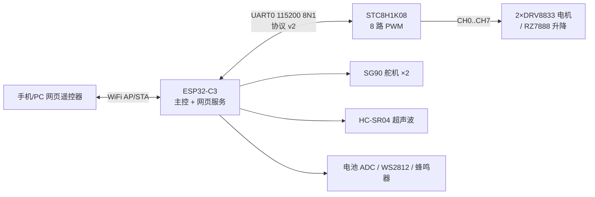

# SMARS 小车主控系统（ESP32-C3 + STC8H1K08）

SMARS 模块化小车的主控固件：**ESP32-C3** 负责 WiFi 网页遥控与外设（舵机/超声波/电池/灯带/蜂鸣器），
经 UART 以**协议 v2** 指挥 **STC8H1K08** 产生 8 路 PWM 驱动底盘电机与升降机构。



## 组成

| 组件 | 路径 | 技术栈 | 职责 |
|---|---|---|---|
| 主控固件 | [firmware/smars_esp32c3](firmware/smars_esp32c3/README.md) | Rust / esp-idf-svc（ESP-IDF 5.3.2） | WiFi AP+STA、网页遥控器、差速混控、舵机/超声波/电池/灯带/蜂鸣器、安全策略 |
| PWM 固件 | [firmware/stc8h1k08_pwm](firmware/stc8h1k08_pwm/README.md) | C / SDCC + PlatformIO（FwLib_STC8） | 协议 v2 从机：8 路 PWM（2 路独立频率、8 路独立占空比）、急停锁存、量化回读 |

两固件的接口契约为**串口协议 v2**（帧 `AA 55 | cmd | len | payload | CRC8`，
命令/语义/测试向量见 [stc8h1k08_pwm/docs/design.md](firmware/stc8h1k08_pwm/docs/design.md) §4；
ESP32 侧为协议主机实现，`smars-protocol` crate 与 STC 固件逐条对齐并双向单测）。

## 小车型号（Rust feature）

主控固件按 3D 打印件配置切换型号，每台编译期绑定名字（网页标题/热点名 `SMARS-<名字>`）：

| feature | 名字 | 配置 |
|---|---|---|
| `robot-bolt` | bolt | 基础：2 电机组差速 + 超声波测距 |
| `robot-fork` | fork | 夹持：+ 上下/夹持 SG90 ×2 |
| `robot-cargo` | cargo | 装载：+ 上下 SG90（0~60°） |
| `robot-lift` | lift | 叉车：+ 上下 SG90 + N20 升降（RZ7888） |
| `robot-scan` | scan | 超声波云台：SG90 ±60° 转动测距 |
| `robot-truck` | truck | 卡车：4 电机（2×DRV8833 用满 8 路）+ 车斗 2×SG90 联动 0~90° |

可选外设特性（叠加）：`buzz`（开机旋律 + 网页喇叭；未启用 = 硬件不焊蜂鸣器）、
`ws2812`（灯带，灯数 `WS2812_COUNT` 默认 20，效果：常亮/呼吸/彩虹/流水）。

## 快速开始

```bash
# STC8H1K08（8 路 PWM 板）
cd firmware/stc8h1k08_pwm
pio run                      # 编译（SDCC）
pio run -t upload            # stcgal 烧录（P3.0/P3.1 ISP，IRC 22.1184MHz）
make -C test/host test       # 协议/PWM 换算单测

# ESP32-C3（主控）
cd firmware/smars_esp32c3
cargo test                   # 协议/机器人模型单测（host）
cd crates/smars_esp32c3
cargo build --release --features robot-truck,buzz,ws2812
cargo run   --release --features robot-truck,buzz,ws2812   # espflash 烧录
```

上电后连接热点 `SMARS-<名字>`（密码 `smars1234`）访问 `http://192.168.4.1/`，
或在网页 WiFi 设置区配置家庭路由（STA 失败自动回落热点）。
工具链准备与常见坑（ESP-IDF 版本钉死、nightly 钉死、ldproxy 链接参数）见
[smars_esp32c3/README.md](firmware/smars_esp32c3/README.md)。

## 硬件要点

- 8 路 PWM 仅 **2 路独立频率**（PWMA/PWMB 各共享一组 PSCR/ARR），8 路占空比独立；
  实际分辨率 = 1/(ARR+1)，`0x06` 状态查询回读量化后实际值（协议所见即所得）。
- 电机接线：双电机组 CH0/1 左、CH2/3 右；truck 四电机左 = CH0/1+CH4/5、右 = CH2/3+CH6/7；
  叉车升降 CH4/5 → RZ7888。
- 串口交叉：ESP32 IO21(TX)→STC P3.6(RXD)、IO20(RX)←STC P3.7(TXD)；STC P3.0/P3.1 仅 ISP。
- 安全：网页失联 1s 停车、急停锁存（协议 `0x04`/`0x05`）、升降按压 3s 上限、
  电池 <3.00V 欠压切断（网页锁定 + 固件拒动）。

## 验证状态

已验证：两固件全部单测通过（协议/换算/效果引擎/欠压边界）、6 型号 × 特性构建矩阵、
网页 UI 按配置浏览器实测（布局/联动/欠压锁定）。
未验证：目标硬件实测——上电联调清单见
[smars_esp32c3/docs/design.md](firmware/smars_esp32c3/docs/design.md) §9 与
[stc8h1k08_pwm/docs/design.md](firmware/stc8h1k08_pwm/docs/design.md) §9。

## 目录

```
firmware/
├── smars_esp32c3/      # ESP32-C3 主控（Rust）
│   ├── crates/         #   smars-protocol（协议）/ smars-core（模型纯逻辑）/ smars_esp32c3（固件）
│   ├── lib/            #   vendored esp-idf-svc（单行 IDF 5.3 补丁）
│   └── docs/           #   设计文档（配置矩阵、协议、安全、工具链约束、验证记录）
└── stc8h1k08_pwm/      # STC8H1K08 八路 PWM（C / SDCC）
    ├── src/ lib/ test/ #   固件源码 / vendored FwLib_STC8 / 主机端单测
    └── docs/           #   设计文档（协议 v2 定稿）
```

## 许可

GPL-3.0（见 [LICENSE](LICENSE)）。vendored 第三方组件保留各自许可证
（FwLib_STC8 / esp-idf-svc 均为 Apache-2.0）。
